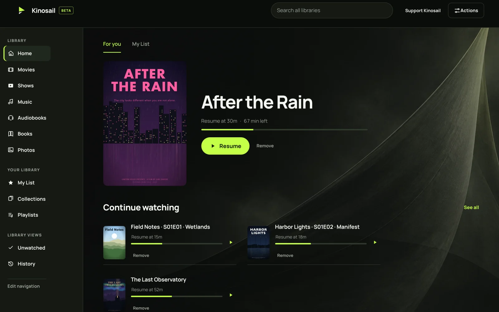
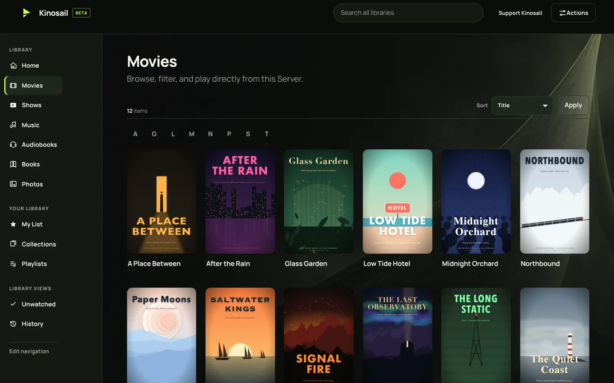
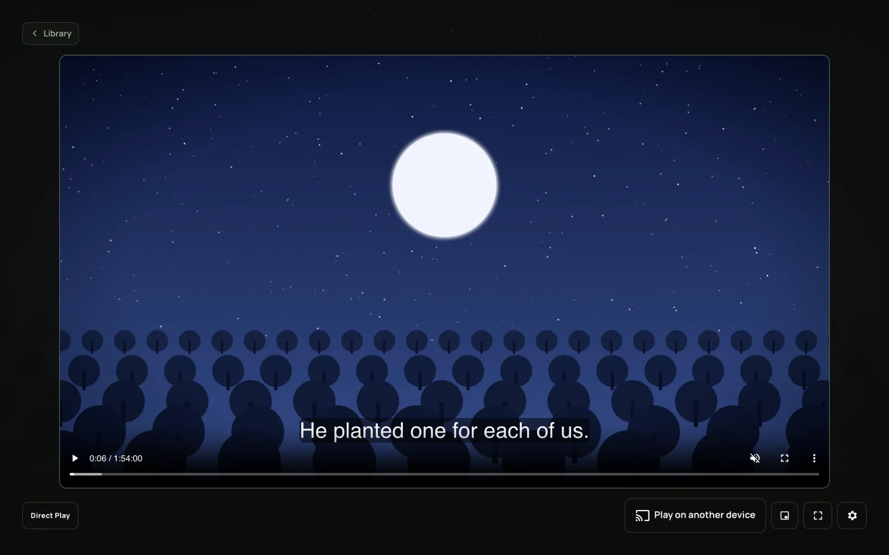
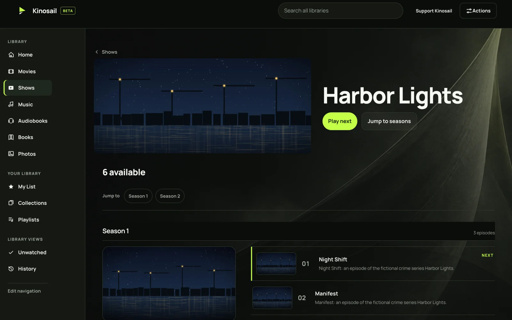
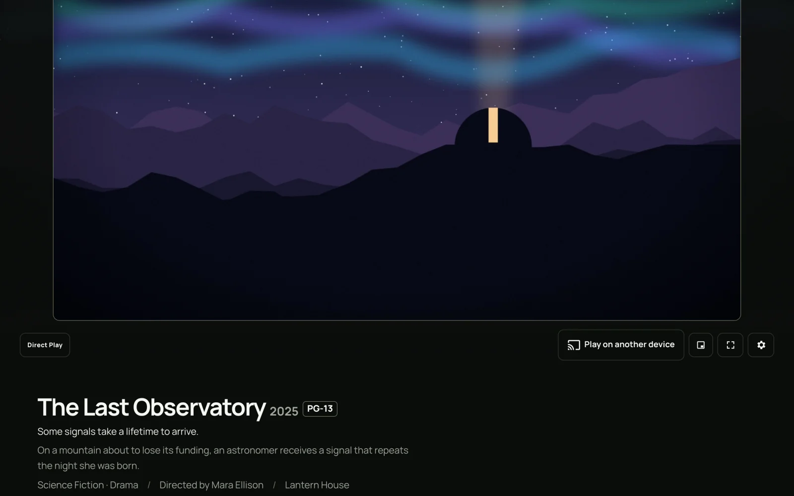
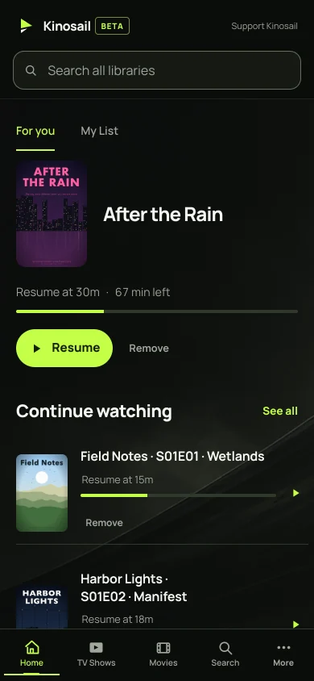
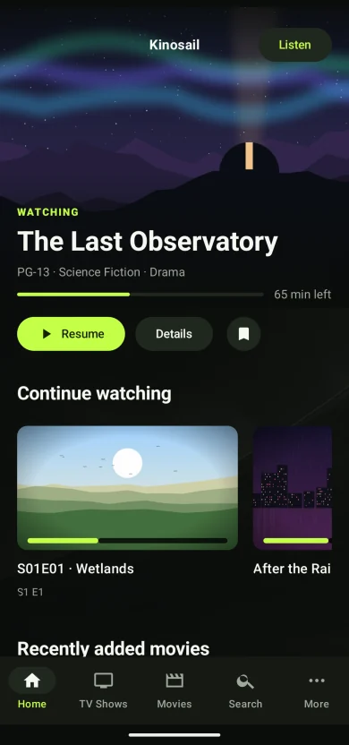
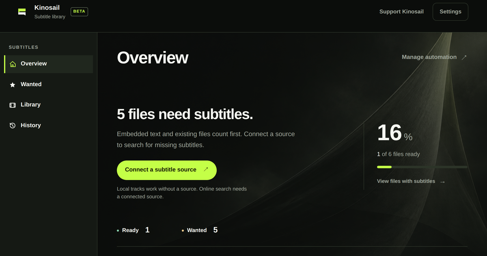

# Kinosail

**A free, self-hosted media server for your movies, shows, music, audiobooks, books, and photos.** Kinosail is a private alternative to Plex, Jellyfin, and Emby. It runs in one Docker container, reads your media folders read-only, and needs no vendor account. Remote streaming and hardware transcoding are free.

**[Quick start](#quick-start)** · **[Website](https://kinosail.com/)** · **[Docs](https://kinosail.com/docs/)** · **[Compare with Plex, Jellyfin, and Emby](https://kinosail.com/compare/)** · **[NAS and Proxmox](https://kinosail.com/getting-started/platforms/)**

<p align="center">
  <a href=".github/assets/player-home-desktop.webp"></a>
</p>

<p align="center"><em>The real Kinosail web Player with a fictional demo library. <a href="engineering/documentation/DEMO-ASSETS.md">How these screenshots were made</a>.</em></p>

## Why Kinosail

- **Everything is free.** The Server, the web Player, remote streaming, hardware transcoding, and skip intro have no paid tier.
- **No account between you and your media.** You create the Owner on your own Server. There is no Kinosail account, relay, or analytics service.
- **Every kind of media.** Movies, TV shows, music, audiobooks, books, comics, and photos share one library and one search.
- **Direct Play first.** Kinosail sends the original file when a device can play it. It converts only when needed, with Intel Quick Sync, NVIDIA, AMD, VA-API, Apple VideoToolbox, or Rockchip acceleration.
- **Secure by default.** Passkeys and multi-factor sign-in are built in. The container runs as a non-root user with a read-only root filesystem, and your media is mounted read-only.
- **Made for a household.** Viewer Profiles keep progress separate and limit libraries. Watch Rooms keep everyone in sync.
- **Switch without starting over.** Import watched state and resume positions from Plex or Jellyfin, and keep using compatible Jellyfin mobile apps.
- **Built to automate.** Use the versioned HTTP API, or connect an AI assistant through the built-in MCP server.

## Quick start

You need Docker on 64-bit Linux (amd64 or arm64). Docker Desktop on macOS works for local use. Replace the media path with a folder that exists on the Docker host:

```sh
export KINOSAIL_MEDIA_PATH="/absolute/path/to/your/media"

docker run --detach --name kinosail \
  --restart unless-stopped --init \
  --user 10001:10001 --read-only \
  --cap-drop ALL \
  --security-opt no-new-privileges:true \
  --publish 127.0.0.1:38127:38127 \
  --mount type=volume,source=kinosail-config,target=/config \
  --mount type=volume,source=kinosail-cache,target=/cache \
  --mount type=volume,source=kinosail-backups,target=/backups \
  --mount "type=bind,source=${KINOSAIL_MEDIA_PATH},target=/media,readonly" \
  --tmpfs /tmp:rw,noexec,nosuid,nodev,size=256m \
  --tmpfs /run:rw,noexec,nosuid,nodev,size=16m \
  --env KINOSAIL_DATA_DIR=/config \
  --env KINOSAIL_CACHE_DIR=/cache \
  --env KINOSAIL_MEDIA_DIR=/media \
  ghcr.io/kinosail/kinosail-player:latest
```

1. Open <https://localhost:38127>. Your browser warns about the local certificate. Trust it only for your own Server.
2. Create the Owner with a password of at least 12 characters, then add a passkey or authenticator app.
3. Add a library folder under `/media`, such as `/media/Movies`, and press Play.

Prefer Docker Compose or a signed, pinned install? Follow the [Docker quickstart](https://kinosail.com/quickstart/). For TrueNAS, Unraid, ZimaOS, CasaOS, Synology, QNAP, Portainer, Dockge, or Proxmox VE, use the [platform install guide](https://kinosail.com/getting-started/platforms/). Catalog submissions are in review for [TrueNAS](https://github.com/truenas/apps/pull/5924) and [ZimaOS/CasaOS](https://github.com/IceWhaleTech/CasaOS-AppStore/pull/1069), and [Unraid templates](https://github.com/Kinosail/kinosail-unraid-templates) are ready.

## Screenshots

| | |
| --- | --- |
| <a href=".github/assets/player-movies-desktop.webp"></a> | <a href=".github/assets/player-watch-desktop.webp"></a> |
| **Browse** every library with posters, sorting, and an A–Z jump bar. | **Watch** with Direct Play, subtitles, casting, and picture-in-picture. |
| <a href=".github/assets/player-show-desktop.webp"></a> | <a href=".github/assets/player-film-detail.webp"></a> |
| **Shows** know what to play next. | **Every title** has its own page. |

<p align="center">
  
  &nbsp;&nbsp;
  
</p>

<p align="center"><em>The web Player on a phone, and the Android app. All films, posters, and videos are fictional.</em></p>

## How Kinosail compares

| Feature | Kinosail | Plex | Jellyfin | Emby |
| --- | --- | --- | --- | --- |
| Server price | Free | Free, with paid Plex Pass | Free | Free, with paid Premiere |
| Remote streaming of your media | Free | Plex Pass or Remote Watch Pass | Free | Free |
| Hardware transcoding | Free | Plex Pass | Free | Premiere |
| Skip intro and credits | Free | Plex Pass | Plugins | Premiere |
| Vendor account required | No | Yes | No | No |
| TV apps in app stores | Not yet | Yes | Yes | Yes |
| Live TV and DVR | No | Yes | Yes | Premiere |
| Lifetime price | $0 | $749.99 | $0 | $119 |
| License | Source-available | Proprietary | GPL-2.0 | Proprietary |

Checked on October 26, 2026. Read the full comparisons, with sources: [Kinosail vs Plex](https://kinosail.com/compare/plex/) · [Kinosail vs Jellyfin](https://kinosail.com/compare/jellyfin/) · [Kinosail vs Emby](https://kinosail.com/compare/emby/).

## Watch on your devices

| Client | Status |
| --- | --- |
| Web Player | Included. Works in modern desktop and mobile browsers. |
| TVs and speakers | **Play on another device** sends to AirPlay, Google Cast, and DLNA receivers. |
| Compatible Jellyfin apps | Some iOS and Android apps connect after the Owner turns on compatibility and trusted HTTPS. [Setup and limits](https://kinosail.com/getting-started/connect-devices/). |
| Kinosail Apple apps | iPhone, iPad, Apple TV, and Apple Watch [source clients](apps/player/apps/native/README.md). They can also connect to Jellyfin, Emby, and Plex servers. No App Store release yet. |
| Kinosail Android apps | Phone, tablet, Android TV, and Wear OS [source clients](apps/player/apps/android/README.md). No Play Store release yet. |

Device format support varies. Check the [media compatibility guide](https://kinosail.com/reference/media-compatibility/) when you plan a library.

## Switch from Plex or Jellyfin

Run Kinosail beside your current server on the same folders. Your media stays read-only, so nothing changes until you decide. Then open **Settings → Migration** to preview and import watched state, resume positions, Jellyfin favorites, and supported playlists. You can keep a recurring sync while your household tries it. [Read the import guide](https://kinosail.com/owner-guide/migration/).

## Kinosail Subtitles

[Kinosail Subtitles](https://kinosail.com/subtitles/) is a separate, free app for movies and episodes. It checks existing text tracks, searches the providers you configure, validates matches, and saves sidecar files beside your videos. It runs without Player and needs a writable media mount.

<p align="center">
  <a href="apps/subtitles/docs/assets/images/subtitles-dashboard-1200.png"></a>
</p>

**[Install Subtitles](https://kinosail.com/subtitles/getting-started/install/)** · **[Subtitles guide](https://kinosail.com/subtitles/)** · **[Install both apps](https://kinosail.com/getting-started/platforms/)**

## Documentation

| What you need | Where to start |
| --- | --- |
| Install and first setup | [Docker quickstart](https://kinosail.com/quickstart/) · [First setup](https://kinosail.com/getting-started/first-setup/) · [Add your media](https://kinosail.com/getting-started/add-media/) |
| Use the Player | [All features](https://kinosail.com/features/) · [Playback](https://kinosail.com/user-guide/playback/) · [Profiles](https://kinosail.com/user-guide/profiles/) |
| Run the Server | [Owner guide](https://kinosail.com/owner-guide/) · [Hardware acceleration](https://kinosail.com/owner-guide/playback/) · [Remote access](https://kinosail.com/owner-guide/remote-access/) · [Backups and updates](https://kinosail.com/owner-guide/backups-and-updates/) |
| Build an integration | [HTTP API](https://kinosail.com/reference/api/) · [MCP guide](https://kinosail.com/developer-guide/mcp/) |
| Get help | [Troubleshooting](https://kinosail.com/troubleshooting/) · [FAQ](https://kinosail.com/faq/) · [Support](SUPPORT.md) · [Private security reporting](SECURITY.md) |

## License

Kinosail is **source-available under the [PolyForm Perimeter License 1.0.1](LICENSE)**. You can read, build, and run it for free. It is not OSI-approved open source. Read [LICENSING.md](LICENSING.md) before you redistribute, rebrand, host, or build a competing product. Contributions follow the [contributor agreement](CONTRIBUTING.md).

The web Player is in beta. Player and Subtitles have independent containers, state, documentation, and releases. Passing builds on protected `main` publish signed `latest` images for changed apps. See [why Kinosail exists](https://kinosail.com/why/) for the project's goals and its use of AI-assisted engineering.

Plex, Jellyfin, and Emby are trademarks of their owners. Kinosail is not affiliated with them.

<details>
<summary>For contributors: repository map and checks</summary>

```text
apps/player/       Player Server, web app, docs, and source clients
apps/subtitles/    Subtitles Server, web app, and docs
packages/          Shared Go operations and contracts
engineering/       Architecture, research, and delivery guidance
scripts/           Shared build and quality tooling
```

Use the Go version in [go.work](go.work). Start with the [contribution guide](CONTRIBUTING.md) for setup, app-scoped commands, and required checks. GitHub-hosted CI verifies selected app tests, browser journeys, and security gates before integration.

</details>
